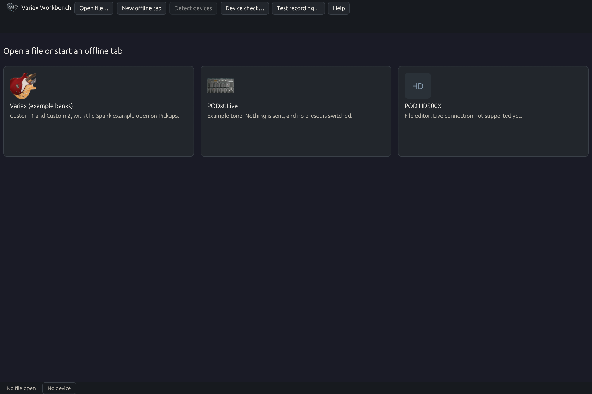
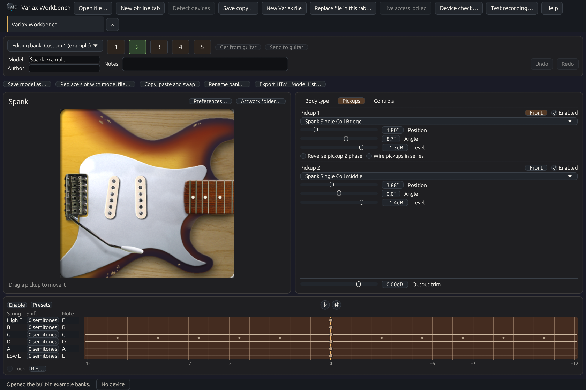
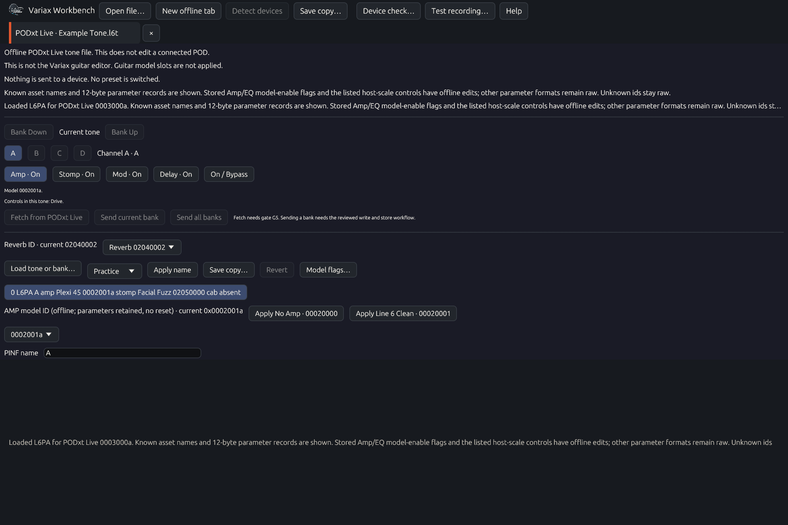
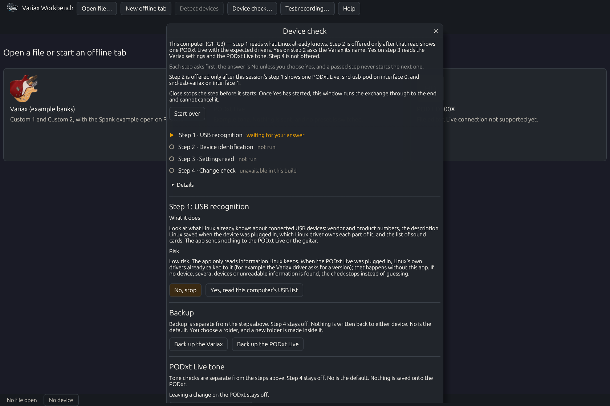

# Variax Workbench

Variax Workbench is an independent Rust app for editing Line 6 Variax guitars
and POD processors. The goal is to bring preset editing, libraries, backups,
recording, and device maintenance into one app that can work offline.

The first target is a Variax 600 connected by VDI to a PODxt Live on Linux.
Other devices, including Workbench HD guitars and the POD HD500X, and native
Windows and macOS support are longer-term goals. [Product vision](docs/product-vision.md)

## Screenshots

Captured in floating windows with built-in examples and device discovery disabled.

| Start screen | Variax editor |
| --- | --- |
|  |  |
| **PODxt editor** | **Device check** |
|  |  |

## What works today

- **Variax editor.** Edit models, pickups, wiring, and tuning. Browse banks and
  collections, undo changes, and save a new copy. File editing works offline.
- **PODxt editor.** Edit supported amp, cab, and effect settings. Browse and
  organize tone libraries and save copies. Built-in examples work offline.
- **HD500X files.** Open presets, setlists, and bundles, edit supported settings,
  and save copies. File editing only.
- **Device connection.** Linux detection and device tabs have been tested on
  the Variax 600 and PODxt Live. Offline tabs work with the rig disconnected.
- **Backups.** Variax settings and PODxt Live library backups have been tested
  on hardware. Full Variax program backup is implemented and verified offline.
- **Live reads and edits.** Device check has read current settings on both
  devices. PODxt Live edit-buffer changes have been tested in owner-run tools.
- **Recording.** Try the recorder with synthetic audio or a WAV file and save
  a take. This workflow is offline only.

## Coming next

- Validate full Variax backups on the rig and verify a safe restore procedure.
- Bring more live guitar and POD workflows into the editors.
- Validate USB recording and playback on Linux.
- Extend device and platform support.

## Known limitations

- Use **Refresh guitar** after connecting or disconnecting the VDI cable if
  the app misses the change.
- The PODxt Live cannot relay large guitar replies. Full program backups use
  smaller reads.
- Native Windows and macOS apps and hardware connections remain untested.
- Live audio and firmware installation are unavailable.

## Safety

**Experimental software. Use entirely at your own risk.** This independent,
reverse-engineered project uses AI assistance and has no affiliation with Line 6
or Yamaha. It is provided as is, without warranty or support. Errors may cause
data loss, unsafe audio output, or permanent damage to connected equipment.
Tests and backups cannot guarantee safe operation or recovery. The project
promises no recovery service or continued maintenance. To the extent allowed
by law, the authors and contributors disclaim liability.

Keep equipment unplugged during development and testing. Live access, including
identification and read-only operations, requires explicit authorization for
that procedure. Hardware controls are set at build time. Passing tests and
project issues do not grant permission for a live run.
[Hardware rules](AGENTS.md#hardware-boundary--user-requirement)

## Build and run

With Rust and the Linux build dependencies installed, build and run the offline
editor with the rig unplugged.

```sh
cargo build --no-default-features --features gui --bin variax-workbench-gui
cargo run --no-default-features --features gui --bin variax-workbench-gui -- --display x11
```

Use **Open file** for a preset or **New offline tab** for an example. The
[Linux packaging guide](docs/linux-package.md) covers dependencies and releases.
For a numbered release build, run `python3 scripts/build_release.py`.

## Verify

```sh
cargo fmt --all -- --check
cargo clippy --offline --all-features --all-targets -- -D warnings
cargo test --offline --all-features
(cd crates/line6-devices && cargo test --offline --all-features)
```

The offline checks use test data and fake transports. Original-library
comparisons require separately supplied files. [Reference checks](docs/reproducing-references.md)

## Project links

[Verified status](docs/status.md) · [Roadmap](docs/roadmap.md) ·
[Parallel work](docs/parallel-work.md) · [Project board](https://github.com/users/guirossibrum/projects/17)
